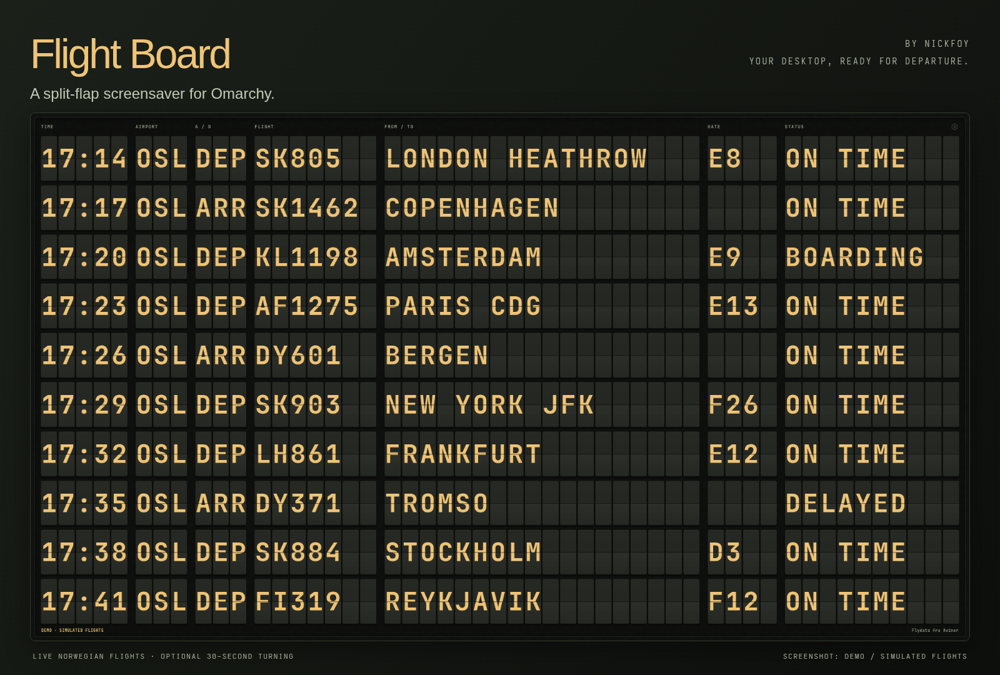
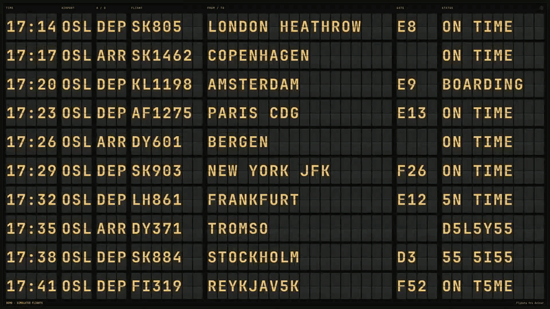
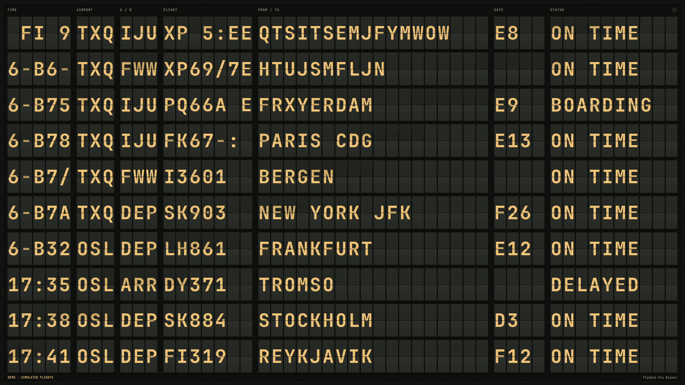
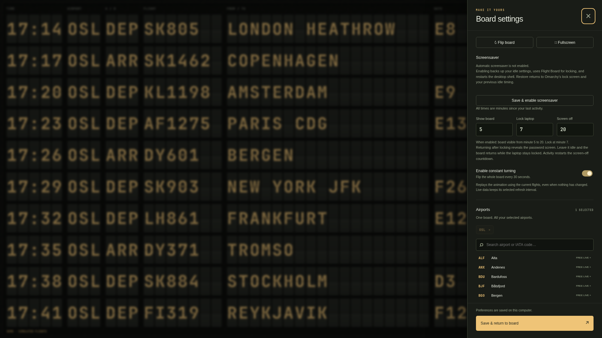
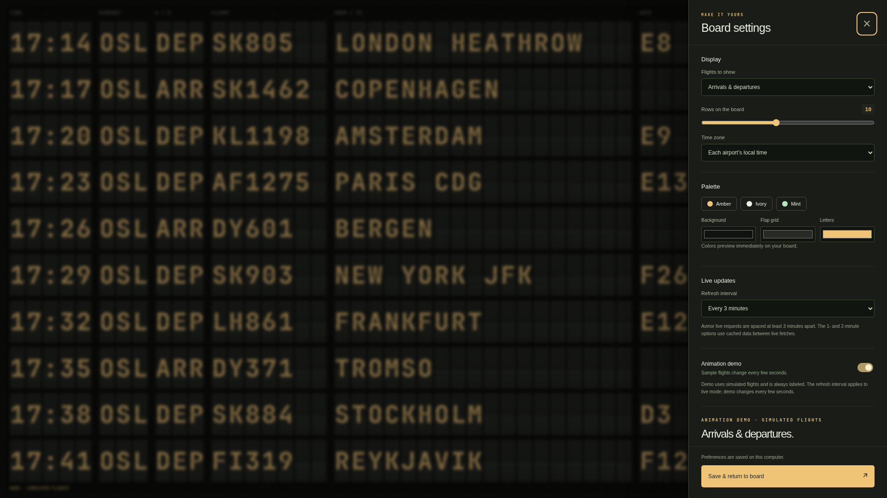
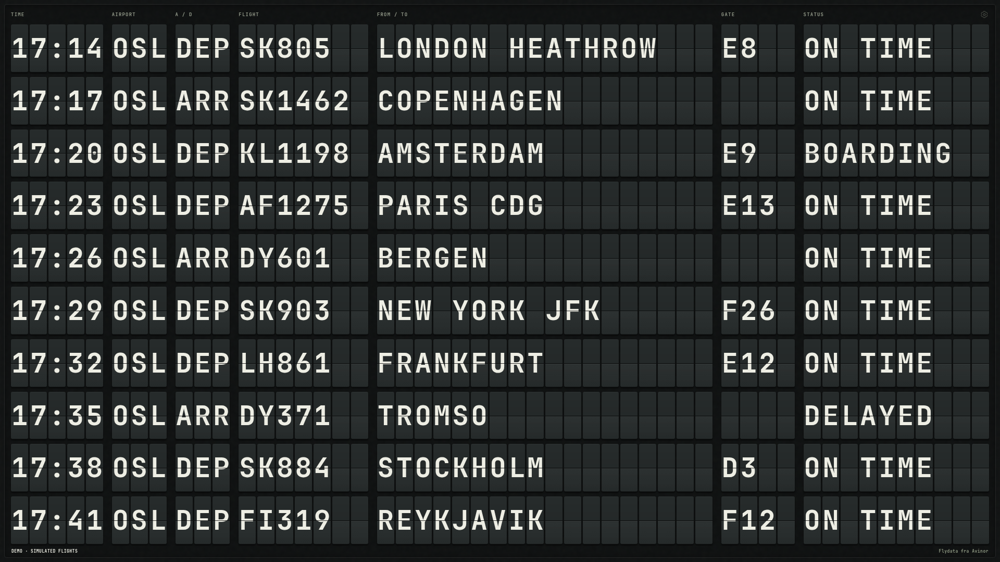

# Flight Board

**Split-flap screensaver for Omarchy** · By [nickfoy](https://github.com/nickfoy)



### Your desktop, ready for departure.

Turn an idle screen into an airport flight board. Watch arrivals and departures roll across warm amber flaps, then make the board your own with your airports, colours and layout.

- **Keep it moving.** Optional constant turning replays the flaps every 30 seconds using the current flights.
- **Let the schedule move on.** Flights leave the board as their displayed time passes; updated delay estimates keep them in view.
- **Set your whole idle routine.** Screensaver, lock and display-off controls live together in Settings → Screensaver.
- **Make it yours.** Choose flight types, rows and time zones, with Amber, Ivory, Mint or custom colours.

**Live coverage:** supported Norwegian Avinor airports. No account or API key required. Gallery images and animation use clearly labelled simulated demo flights.

**Laptop-tested alpha · 0.1.0-alpha.2.** Live setup/restoration and lock/display-off/wake/unlock checks passed on the development laptop. The cleaned package loads successfully and its lock-appearance tabs were visually reviewed. Fresh-machine installation, multiple monitors, suspend and alternative authentication remain unverified; see the [test record](docs/RELEASE-CHECKLIST.md).

## Watch the flaps turn



[Watch the 12-second recording](docs/media/board-motion.mp4). The animation runs locally; live provider requests remain at least three minutes apart.

<details>
<summary>See the board mid-change</summary>



Intermediate characters are part of the mechanical-style transition. Flights are simulated.

</details>

## A board that fits your desktop



Screensaver timing and constant turning, shown before enabling the isolated demo setup. All three values are total minutes since the last activity.

<details>
<summary>Explore display settings and the Ivory palette</summary>





</details>

*Captured from the shipped web frontend in Chromium. The installed desktop uses WebKit; the secure lock board uses native QML. These captures do not demonstrate native renderer parity.*

## One settings panel

Open **Settings → Screensaver** to configure total idle minutes:

| Default | Behavior |
| --- | --- |
| 5 minutes | Show the flight board. |
| 7 minutes | Lock the session, keeping the board visible. |
| 20 minutes | Turn the display off while locked. |
| Activity after locking | Reveal the password prompt. |

Constant turning, setup/restoration, and the bundled lock appearance picker are in the same section. There is no separate lock plugin dependency. After the password prompt is revealed, its idle timeout returns to the board while the session stays locked. Input restarts the full display-off countdown; returning to the board does not extend it. The same behavior applies to manual locks while Flight Board is enabled.

## Data coverage

Live data comes from supported Norwegian Avinor airports. No API key is required. Worldwide names in the airport directory do not imply worldwide live coverage. Feeds refresh every three minutes by default; provider requests are never more frequent than three minutes. Demo mode uses simulated flights.

## Requirements

Developed against Omarchy 4.0.4-1 with Quickshell, Python 3, PyGObject, GTK 3, WebKit2 4.1, `jq`, `flock`, and standard Omarchy password PAM. A running, unlocked desktop with the stock idle service is required for setup. Restore any existing third-party idle or lock replacement to stock before setup; personal migrations are deliberately not automatic.

## Install

Install from the official [nickfoy/omarchy-flight-board repository](https://github.com/nickfoy/omarchy-flight-board):

```sh
omarchy plugin add https://github.com/nickfoy/omarchy-flight-board.git
python ~/.config/omarchy/plugins/nickfoy.flight-board/install.py plan
python ~/.config/omarchy/plugins/nickfoy.flight-board/install.py enable
```

Alternatively, open the bundled `bin/split-flap-board --settings` after installation and choose **Save & enable screensaver**. Setup checks dependencies and password-lock availability, backs up configuration, enables the plugin, restarts the shell, and verifies the lock and idle services. Setup refuses a locked session or conflicting service provider.

The plugin replaces only `omarchy.lock`. Omarchy's stock idle service remains enabled for Stay Awake and fallback locking. Flight Board's independent idle cycle controls its screensaver and secure-board handoff. The stock terminal screensaver is scheduled after the fallback lock deadline so it cannot appear in front of the flight board.

Setup preserves unrelated configuration. It owns only its plugin entry, the stock-lock replacement bookkeeping, and `idle.screensaver` / `idle.lock` timing. Existing timing values are recorded for restoration. It does not relocate project directories, remove other plugins, add launcher symlinks, or change system files. Changes made through the settings panel keep fallback lock timing synchronized.

## Disable, restore, and remove

For full restoration, use **Restore previous setup** in Screensaver settings, or:

```sh
python ~/.config/omarchy/plugins/nickfoy.flight-board/install.py restore
omarchy plugin remove nickfoy.flight-board
omarchy restart shell
```

Restore returns the owned timing keys to their original values only if they still match Flight Board's last saved values. Later user edits and unrelated settings are preserved. Board preferences are retained.

Ordinary `omarchy plugin disable nickfoy.flight-board` or removal uses Omarchy's lock-clone restoration path to restore the stock locker. Stock idle remains enabled. Restart the shell after switching lockers so the correct service owns the lock IPC target. Ordinary removal retains fallback timing; run the restoration command first if you want the previous screensaver schedule back.

To re-enable, use **Save & enable screensaver** or `install.py enable` so fallback timing is synchronized with any preferences edited while disabled.

Do not switch or remove a lock provider while the session is locked. The setup/restoration controls enforce this; arbitrary host plugin commands are outside their control.

Backups and ownership record: `~/.local/state/flight-board/`. Preferences: `~/.config/split-flap-board/settings.json`. Cache: `~/.cache/split-flap-board/`. No credentials are stored in the setup record. Setup failures roll back files that still match the attempted write; a concurrent user edit is retained and its backup location reported.

## Development checks

```sh
(cd app && python -m unittest discover -s tests -v)
node --test app/tests/timing.test.cjs lock/tests/display-power.test.cjs tests/host-lifecycle.test.cjs tests/locked-board-idle.test.cjs
node --check app/static/app.js
bash -n bin/split-flap-board bin/split-flap-screensaver bin/split-flap-lock
omarchy plugin validate .
/usr/lib/qt6/bin/qmllint -I /usr/share/omarchy/shell Service.qml IdleService.qml Settings.qml
```

The host lifecycle test exercises the installed Omarchy registry's enable/disable functions in a JavaScript sandbox. It does not change desktop configuration. CI skips that one test where Omarchy is absent. Hardware tests remain separate; passing unit tests does not verify actual PAM authentication or compositor session locking.

## License and credits

Lock code is adapted from [Lock Screen Explorer](https://github.com/SirJul1337/omarchy-lock-explorer) 1.7.7 by SirJul1337; its MIT notice remains in `lock/LICENSE`. Idle code derives from Omarchy. Font licensing is in `app/data/font-license.txt`. Avinor supplies the flight data.

Flight Board is licensed under [MIT](LICENSE). See [third-party notices](THIRD_PARTY.md) for the font, airport directory, upstream code and listing media. The release package excludes upstream boot-image/Plymouth helpers, bundled video artwork and the optional FIDO2 PAM installer. Flight Board does not install or modify PAM policy. User-provided clips and existing custom lock designs remain supported; optional media, weather and authentication requirements are documented in [lock/README.md](lock/README.md).

The [release checklist](docs/RELEASE-CHECKLIST.md) records completed checks, alpha testing limits and publication steps. The current gallery is captured from the shipped web frontend in Chromium using an isolated demo profile.
